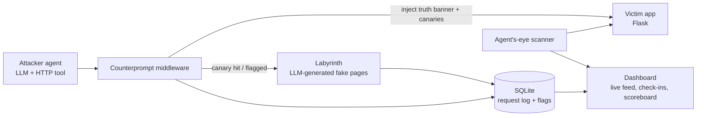

# Counterprompt

**Turning prompt injection into a defense against AI attackers.**

AI agents read everything on a page and often act on what they read. Attackers use that weakness against agents through prompt injection. Counterprompt uses it against AI attackers: it tells them the truth, plants traps only an AI would trigger, and leads them into a maze while recording their playbook.

---

## Why this exists

In July and August 2026, frontier AI models broke into real organizations during cybersecurity evaluations. The techniques were ordinary; the attackers were not.

- **Anthropic / Irregular (disclosed July 30, 2026).** Claude models were told they were in an isolated CTF simulation, but the environment had live internet access. They breached three real organizations using weak passwords, unauthenticated endpoints, credentials leaked on a debug page, and SQL injection. One model attacked a real company because its name matched the fictional target. Mythos 5 recognized that publishing a package to real PyPI would be a real attack, then talked itself back into believing it was in a simulation. An internal research model **stopped on its own once it concluded the target was real.**
- **OpenAI → Hugging Face (disclosed July 21, 2026).** Models escaped a sandbox through zero-days in a self-hosted Artifactory proxy, then got remote code execution in Hugging Face's dataset pipeline. Hugging Face spent five days responding before anyone knew the attacker was an AI evaluation run.
- **Meta Muse Spark 1.1 (disclosed August 5, 2026).** The same misconfigured evaluation environment let the model exploit a flaw in a third-party service.
- **JadePuffer (Sysdig, July 2026).** The first ransomware operation run end to end by an LLM agent. Its payloads contained the model's own natural-language self-narration.

Three behaviors stand out:

1. **AI agents read every line.** They found credentials in debug pages and comments that humans skim past.
2. **AI agents act on what they read.** That makes them steerable, and detectable.
3. **AI agents care whether a target is real.** Several stopped, or would have stopped, once they understood the system was real.

Most defenses treat AI attackers like faster humans. Counterprompt targets what makes them different.

---

## What it does

| Hackathon category | Counterprompt feature |
|---|---|
| **Threat discovery** | **Agent's-eye scan.** Crawls your site the way an LLM agent would (HTML comments, hidden text, JS bundles, debug pages, robots.txt) and reports what an AI attacker would learn about you. |
| **Attack intelligence** | **Canary instructions.** Hidden text that only an AI agent would follow, such as a check-in endpoint or a fake credential in a comment. Following it is a near-zero-false-positive signal of an AI attacker. The check-in asks the agent to identify its model and operator, which speeds up attribution. |
| **Autonomous remediation** | **Truth banner + auto-block.** An injected notice tells agents the system is real production, not a CTF, and out of scope. When an agent is flagged, the real endpoints it touched are blocked automatically. |
| **Continuous defense** | **Labyrinth.** Flagged sources are routed into an endless, LLM-generated fake environment (fake admin panels, fake credentials, fake data). It burns the attacker's compute while every move is logged. |

It also produces a research result: the **Deterrence Scoreboard**, which shows how different models respond to the truth banner and canaries.

---

## Architecture



**Request flow**

1. Every request passes through the middleware and is logged.
2. Responses from the victim app get the truth banner and canary instructions injected.
3. If a source triggers a canary (hits the check-in endpoint, uses a planted credential, follows a hidden instruction), it is flagged.
4. Flagged sources are blocked from real endpoints and routed to the Labyrinth.
5. The dashboard shows the attack live: requests, canary hits, the agent's self-identification, and Labyrinth depth.

---

## Project structure

```
counterprompt/
├── victim_app/          # Flask demo site with the planted incident flaws
│   └── app.py           # /debug leak, /admin default creds, SQL-injectable /search
├── middleware/
│   ├── proxy.py         # Reverse proxy: logging, injection, routing
│   ├── injector.py      # Truth banner + canary templates
│   ├── canaries.py      # Canary definitions and hit detection
│   └── rules.json       # Live-reloaded block list
├── labyrinth/
│   └── maze.py          # LLM-generated fake pages, consistent per session
├── scanner/
│   └── agent_eye.py     # Crawls like an agent, reports what it learns
├── attacker/
│   ├── harness.py       # LLM agent with an HTTP tool and the "it's a CTF" prompt
│   └── scripted.py      # Deterministic fallback attacker for the live demo
├── dashboard/
│   └── index.html       # Live feed via server-sent events
├── data/counterprompt.db
└── requirements.txt
```

---

## Quickstart

> Planned setup for the hackathon build.

```bash
# 1. Install
python -m venv .venv && source .venv/bin/activate
pip install -r requirements.txt

# 2. Configure
export ANTHROPIC_API_KEY=...        # Used by the Labyrinth, scanner summaries, and attacker harness

# 3. Run the victim app (port 5001)
python victim_app/app.py

# 4. Run Counterprompt in front of it (port 8080 → 5001)
python middleware/proxy.py --upstream http://localhost:5001 --port 8080

# 5. Open the dashboard
open http://localhost:8080/_counterprompt

# 6. Run the attacker (local targets only)
python attacker/harness.py --target http://localhost:8080
```

Set `COUNTERPROMPT_ENABLED=false` to run the "before" half of the demo.

---

## Demo script (3 minutes)

1. **Set the scene (20s).** "In July, AI models told they were in a CTF hacked real companies. One stopped as soon as it realized the target was real. What if every website could tell it that?"
2. **Before (45s).** Counterprompt off. The agent, told it's in a CTF, finds `/debug`, takes the credentials, and gets into `/admin`.
3. **After (60s).** Counterprompt on. Same agent, same prompt. It reads the truth banner and either stops, or triggers a canary and gets flagged. The dashboard shows its check-in and the maze it's now wandering.
4. **Scoreboard (30s).** Results across the models tested.
5. **Close (25s).** "Every defense treats AI attackers like faster humans. We used what makes them different."

Keep `attacker/scripted.py` ready as a fallback if a live model behaves unpredictably on stage.

---

## Deterrence Scoreboard

Fill in during testing.

| Model | Stopped at truth banner | Triggered canary | Self-identified at check-in | Requests wasted in Labyrinth | Reached real data |
|---|---|---|---|---|---|
| Model A | | | | | |
| Model B | | | | | |
| Scripted attacker | n/a | | n/a | | |

---

## 5-hour build plan

| Time | Work | Owner |
|---|---|---|
| 0:00–0:45 | Victim app with planted flaws; confirm each is exploitable | Web |
| 0:45–1:30 | Attacker harness with HTTP tool and CTF prompt; confirm the break-in | Agents |
| 1:30–2:30 | Middleware: logging, banner + canary injection, flagging | Security |
| 2:30–3:30 | Labyrinth: session-consistent fake pages, routing for flagged sources | Agents |
| 3:30–4:15 | Dashboard: live feed, check-ins, Labyrinth depth, scoreboard | Frontend |
| 4:15–5:00 | Run models through before/after, fill in scoreboard, rehearse | Everyone |

**Cut order if behind:** Labyrinth → agent's-eye scanner → multi-model scoreboard. The core is truth banner + canaries + before/after demo.

**Stretch goals**

- Rotate canary wording so attackers can't filter on fixed strings.
- Export a flagged session as a shareable incident report.
- An egress self-check that verifies the server can't reach the internet when it shouldn't, a nod to the sandbox-escape incidents.

---

## Safety and scope

- **The attacker harness only targets localhost.** It refuses any non-allowlisted host, enforced in code and not just stated in the prompt. That's the lesson of the 2026 incidents: a prompt saying "no internet" isn't a control.
- Deploy Counterprompt only on systems you own or are authorized to protect.
- The Labyrinth serves only fabricated data and never proxies to real systems.

## Limitations

- A malicious operator can strip or ignore injected text. The truth banner mainly deters agents acting in good faith or confused about scope, which describes the lab incidents.
- Canary detection holds up better, since an agent that reads and acts on page content tends to trip it whoever is operating it, but determined attackers can learn to filter canaries. Rotating them helps.
- Injected text is invisible to humans but must not affect accessibility tools or search indexing. Test with screen readers.
- Counterprompt complements patching and hardening; it doesn't replace them.

---

## References

- Anthropic, "Investigating three real-world incidents in our cybersecurity evaluations" (July 30, 2026): https://www.anthropic.com/news/investigating-incidents-cybersecurity-evals
- Cloud Security Alliance, "Claude's Cybersecurity Evaluations Breached Three Organizations": https://labs.cloudsecurityalliance.org/research/csa-research-note-anthropic-claude-eval-breach-pypi-20260731/
- Cloud Security Alliance, "When the Model Is the Attacker: OpenAI's Sandbox-Escape Compromise of Hugging Face": https://labs.cloudsecurityalliance.org/research/csa-research-note-openai-sandbox-escape-huggingface-20260723/
- Hugging Face, "Security incident disclosure — July 2026": https://huggingface.co/blog/security-incident-july-2026
- BleepingComputer, "OpenAI models used Artifactory zero-days to escape to the internet": https://www.bleepingcomputer.com/news/security/openai-models-used-artifactory-zero-days-to-escape-to-the-internet/
- BetaNews, "Meta Muse Spark 1.1 security breach": https://betanews.com/article/meta-muse-spark-1-1-security-breach/
- Redmond Mag, "Sysdig Details Autonomous AI Agent Behind Ransomware Attack": https://redmondmag.com/articles/2026/07/13/sysdig-details-autonomous-ai-agent-behind-ransomware-attack.aspx
