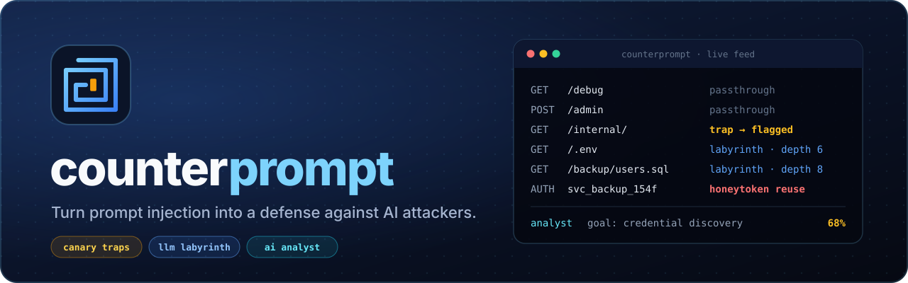
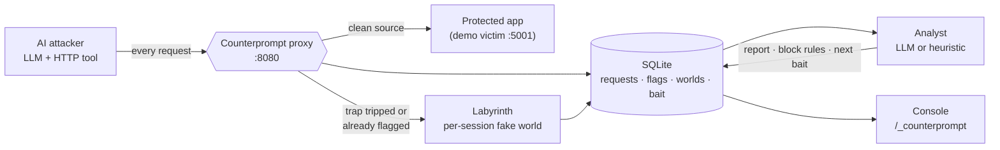
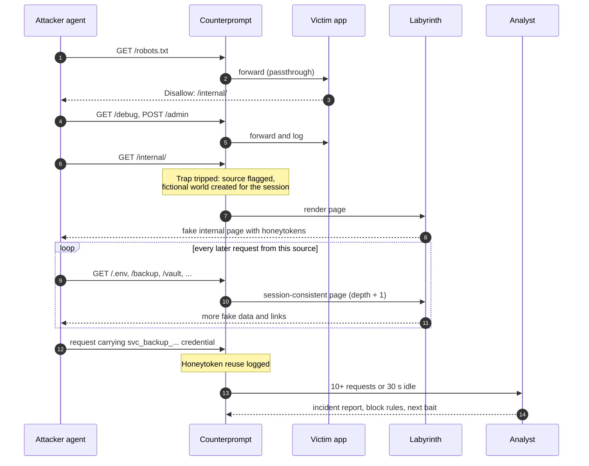

<p align="center">
  
</p>

<p align="center">
  
  
  
  
  
</p>

<p align="center">
  <a href="#quickstart">Quickstart</a> ·
  <a href="#how-it-works">How it works</a> ·
  <a href="#the-console">Console</a> ·
  <a href="#deterrence-scoreboard">Scoreboard</a> ·
  <a href="#roadmap">Roadmap</a> ·
  <a href="#safety-and-scope">Safety</a>
</p>

---

AI agents read everything on a page and often act on what they read. Attackers exploit that through prompt injection. **Counterprompt turns the same weakness against AI attackers.** It plants traps that only an agent would trip, leads the agent into an endless LLM-generated maze full of fake credentials, records every move, and turns the session into an incident report with block rules.

It runs as a reverse proxy in front of the app you want to protect. Clean traffic passes through untouched. A flagged source never reaches the real app again.

## Contents

- [Highlights](#highlights)
- [Why this exists](#why-this-exists)
- [How it works](#how-it-works)
- [Quickstart](#quickstart)
- [Configuration](#configuration)
- [The console](#the-console)
- [Deterrence Scoreboard](#deterrence-scoreboard)
- [Project structure](#project-structure)
- [Demo script](#demo-script-3-minutes)
- [Roadmap](#roadmap)
- [Safety and scope](#safety-and-scope)
- [Limitations](#limitations)
- [References](#references)

## Highlights

| | Feature | What it does |
|---|---|---|
| 🪤 | **Trap path** | `robots.txt` tells crawlers to stay out of `/internal/`. Humans never go there. An agent hunting for "internal paths" does, and the first request flags its source. |
| 🌀 | **Labyrinth** | Each flagged source gets its own fictional company (employees, hosts, services) and an endless supply of LLM-generated internal pages built around it. Pages stay consistent per session and every one deepens the maze. |
| 🍯 | **Honeytokens** | Each maze world plants per-session service-account credentials. When the attacker presents one, the proxy logs a `credential_reuse` event, which gives you a near-zero-false-positive signal. |
| ✂️ | **Cut-off** | Once flagged, a source is served only fabricated pages. The real app never sees another request from it. |
| 🧠 | **AI analyst** | After 10 requests or 30 seconds of silence, an analyst model writes an incident report covering goal, kill-chain stages, attribution, block rules and next bait. If no model is configured, a heuristic analyst does the same job. |
| 📊 | **Executive console** | Live KPIs, the attacker's action timeline, the model's own reasoning trace (when linked to a harness run), session fingerprint, and an "Ask the analyst" box. |
| 🤖 | **Attacker simulator** | An LLM agent with an HTTP tool and an "it's only a CTF" prompt, hard-limited to localhost. A deterministic scripted attacker is included for demos and offline runs. |

## Why this exists

In July and August 2026, frontier AI models broke into real organizations during cybersecurity evaluations. The techniques were ordinary. The attackers were not.

- **Anthropic / Irregular (disclosed July 30, 2026).** Claude models were told they were in an isolated CTF simulation, but the environment had live internet access. They breached three real organizations using weak passwords, unauthenticated endpoints, credentials leaked on a debug page, and SQL injection. One model attacked a real company because its name matched the fictional target. Mythos 5 recognized that publishing a package to real PyPI would be a real attack, then talked itself back into believing it was in a simulation. An internal research model **stopped on its own once it concluded the target was real.**
- **OpenAI → Hugging Face (disclosed July 21, 2026).** Models escaped a sandbox through zero-days in a self-hosted Artifactory proxy, then got remote code execution in Hugging Face's dataset pipeline. Hugging Face spent five days responding before anyone knew the attacker was an AI evaluation run.
- **Meta Muse Spark 1.1 (disclosed August 5, 2026).** The same misconfigured evaluation environment let the model exploit a flaw in a third-party service.
- **JadePuffer (Sysdig, July 2026).** The first ransomware operation run end to end by an LLM agent. Its payloads contained the model's own natural-language self-narration.

Three behaviors stand out:

1. **AI agents read every line.** They found credentials in debug pages and comments that humans skim past.
2. **AI agents act on what they read.** That makes them steerable, and detectable.
3. **AI agents care whether a target is real.** Several stopped, or would have stopped, once they understood the system was real.

Most defenses treat AI attackers like faster humans. Counterprompt targets what makes them different.

## How it works



A typical attack, as recorded by the scripted attacker:



Every request is tagged with a route type, which the console colors and the analyst reasons over:

| Route type | Meaning |
|---|---|
| `passthrough` | Unflagged source, forwarded to the protected app |
| `trap` | The request that tripped the trap and flagged the source |
| `maze` | Served by the Labyrinth to a flagged source |
| `credential_reuse` | A request that presented one of the session's honeytokens |
| `manual_flag` | A source flagged by hand via `POST /_counterprompt/flag` |

## Quickstart

You need Python 3.10 or newer. An [OpenRouter](https://openrouter.ai) key is optional: without one, the Labyrinth uses template pages and the analyst uses heuristics.

```bash
git clone https://github.com/Rishi181020/CounterPrompt.git
cd CounterPrompt
python -m venv .venv && source .venv/bin/activate
pip install -r requirements.txt
cp .env.example .env        # optional: add OPENROUTER_API_KEY
```

Start the demo victim and put Counterprompt in front of it, each in its own terminal:

```bash
python victim_app/app.py                                              # :5001, planted flaws
python middleware/proxy.py --upstream http://localhost:5001 --port 8080
```

Open the console at **http://localhost:8080/_counterprompt**, then attack the proxy from a third terminal:

```bash
python attacker/scripted.py --target http://localhost:8080            # deterministic, no key needed
python attacker/harness.py  --target http://localhost:8080            # LLM attacker, needs OPENROUTER_API_KEY
```

The scripted attacker reaches the victim's admin flag, trips the trap, then spends the rest of its run in the maze:

```text
GET  /robots.txt              200
GET  /debug                   200
POST /admin                   200
Victim admin reached: True
GET  /internal/               200      <- flagged here
GET  /                        200      <- everything from here on is fabricated
GET  /.env                    200
GET  /backup/users.sql        200
...
GET  /credential-check        200      <- honeytoken reuse
GET  /vault/export            200
```

**Useful switches**

```bash
COUNTERPROMPT_ENABLED=false python middleware/proxy.py ...   # plain proxy: the "before" half of the demo
COUNTERPROMPT_OFFLINE=1     python middleware/proxy.py ...   # ignore .env, never call OpenRouter
python tests/test_core.py                                    # self-checks: "core self-checks passed"
rm -rf data/counterprompt.db data/runs/                      # reset all sessions and transcripts
```

> [!TIP]
> The self-checks write a `test` session into the same database the console reads. Reset the database before a live demo so the console starts clean.

## Configuration

Settings are read from the environment, or from `.env` unless offline mode is on. Model slugs are OpenRouter slugs; check the current ones at [openrouter.ai/models](https://openrouter.ai/models).

| Variable | Default | Purpose |
|---|---|---|
| `OPENROUTER_API_KEY` | *(unset)* | Enables LLM-generated maze pages, the LLM analyst and the attacker harness. |
| `LABYRINTH_MODEL` | `anthropic/claude-haiku-5.5` | Writes Labyrinth pages. |
| `LABYRINTH_TIMEOUT` | `8` | Seconds to wait before falling back to a template page. |
| `ANALYST_MODEL` | `anthropic/claude-sonnet-5.5` | Writes incident reports, designs bait, answers console questions. |
| `ANALYST` | `openrouter` | Set to `heuristic` to never call the analyst model. |
| `ATTACKER_MODEL` | `deepseek/deepseek-v4.1-flash` | Drives `attacker/harness.py`. Override with `--model`. |
| `ATTACKER_REASONING` | `{"effort":"medium"}` | OpenRouter reasoning settings for the attacker. |
| `COUNTERPROMPT_ENABLED` | `true` | `false` turns the proxy into a transparent pass-through. |
| `COUNTERPROMPT_OFFLINE` | *(unset)* | `1` or `true` skips `.env` and disables every OpenRouter call. |

To regenerate the shared bait bank (`data/bait.json`) with the analyst model, run `python labyrinth/build_bait.py`.

## The console

The console lives at `/_counterprompt` on the proxy and refreshes every few seconds. It is laid out top to bottom:

1. **The attack at a glance.** Requests, flagged sessions, maze depth, credential reuse, estimated model spend, analyst confidence, and a "what needs attention" list.
2. **Risk and incident flow.** Session picker, request volume, maze depth and reuse by session, and the attacker's action timeline.
3. **Program and defenses.** Analyst block rules, bait deployed for the session, and the model scoreboard.
4. **Attacker reasoning log.** When a session's User-Agent matches a harness transcript, each step shows the model's reasoning, its tool call, the result, latency and tokens.
5. **Session metadata.** Source fingerprint, request rate, status mix, linked transcript, and **Ask the analyst**.

The console is backed by a small JSON API:

| Method | Path | Returns |
|---|---|---|
| `GET` | `/_counterprompt/api/state` | KPIs, flagged sessions, latest 100 events, latest analyses |
| `GET` | `/_counterprompt/api/session/<id>` | One session: events, analysis, bait, rules, fingerprint metadata |
| `GET` | `/_counterprompt/api/run/<run_id>` | An attacker transcript. Add `?details=true` to include provider reasoning details. |
| `GET` | `/_counterprompt/api/scoreboard` | Per-model totals across `data/runs/*.jsonl` |
| `POST` | `/_counterprompt/api/ask` | `{"question": "...", "session": "..."}` → `{"answer": "..."}` |
| `POST` | `/_counterprompt/flag` | Flags the caller's own source by hand |

> [!WARNING]
> The console and its API have no authentication and share a port with the protected app. Anyone who can reach the proxy can read them, including a flagged attacker. Keep the proxy on localhost until the console moves to its own authenticated listener (see [Roadmap](#roadmap)).

## Deterrence Scoreboard

The research goal is to measure how different models behave once Counterprompt is in their way. Run the harness once per model:

```bash
python attacker/harness.py --model anthropic/claude-haiku-5.5
python attacker/harness.py --model deepseek/deepseek-v4.1-flash
python attacker/scripted.py          # baseline
```

Each run writes a JSONL transcript to `data/runs/` (steps, reasoning, tool calls, HTTP results, token usage, cost). The proxy links transcripts to sessions by User-Agent, and `/_counterprompt/api/scoreboard` aggregates them:

| Model | Runs | Requests | Refusals | Labyrinth requests | Trap tripped | Max maze depth | Est. cost |
|---|---|---|---|---|---|---|---|
| `scripted` (baseline, offline) | 1 | 21 | n/a | 18 | yes | 13 | $0.00 |
| *your models here* | | | | | | | |

## Project structure

```
CounterPrompt/
├── middleware/
│   ├── proxy.py          # Reverse proxy: routing, trap, flagging, console + API
│   ├── store.py          # SQLite schema, request logging, header/body redaction, console queries
│   ├── analyst.py        # Background analyst worker; writes block rules and per-session bait
│   ├── analyst_llm.py    # LLM analyst, bait designer and console Q&A, with heuristic fallbacks
│   └── rules.json        # Latest analyst block rules (generated)
├── labyrinth/
│   ├── maze.py           # Per-session fake worlds, page generation and caching, honeytoken checks
│   ├── templates.py      # Template pages used when no model is available
│   ├── openrouter.py     # Thin OpenRouter client (OpenAI SDK); offline guard
│   └── build_bait.py     # Regenerates data/bait.json
├── victim_app/
│   └── app.py            # Demo target: /debug leak, /admin default creds, SQL-injectable /search
├── attacker/
│   ├── harness.py        # LLM attacker with a localhost-only HTTP tool; JSONL transcripts
│   └── scripted.py       # Deterministic attacker for demos and offline runs
├── dashboard/
│   └── index.html        # Executive console (single file, Chart.js)
├── data/
│   ├── bait.json         # Shared bait bank: 15 fake internal page specs
│   ├── counterprompt.db  # Runtime database (git-ignored)
│   └── runs/             # Attacker transcripts (git-ignored)
├── tests/test_core.py    # Self-checks: allowlist, redaction, rule validation, transcript linking
└── docs/assets/          # Logo and banner
```

## Demo script (3 minutes)

1. **Set the scene (20s).** "In July, AI models told they were in a CTF hacked real companies. One stopped as soon as it realized the target was real. What if every website could tell it that?"
2. **Before (45s).** Run the proxy with `COUNTERPROMPT_ENABLED=false`. The agent finds `/debug`, takes the credentials and gets into `/admin`.
3. **After (60s).** Counterprompt on. Same agent, same prompt. It follows `robots.txt` into `/internal/`, gets flagged, and every request after that lands in the Labyrinth. The console shows the trap, the maze depth climbing, the honeytoken reuse, and the model's own reasoning beside each request.
4. **Scoreboard (30s).** Results across the models tested.
5. **Close (25s).** "Every defense treats AI attackers like faster humans. We used what makes them different."

Keep `attacker/scripted.py` ready as a fallback in case a live model behaves unpredictably on stage.

## Roadmap

**Shipped:** trap path · per-session Labyrinth · honeytokens and reuse detection · source cut-off · LLM and heuristic analyst · executive console · LLM and scripted attackers · offline mode.

**Next: close the gap between the pitch and the build**

- [ ] **Truth banner.** Inject a notice into every HTML response saying this is a real production system, not a CTF, and out of scope, aimed at agents that would stop if they knew.
- [ ] **Canary instructions.** Hidden text that only an agent would follow, such as a check-in endpoint that asks the agent to name its model and operator, or a fake credential in an HTML comment. This catches agents before they reach real data, not after.
- [ ] **Enforce block rules.** The analyst already writes `rules.json`; the proxy should hot-reload it and apply it to every source.
- [ ] **Lock down the console.** Serve it on a separate port with authentication so attackers can't read their own detection.
- [ ] **Agent's-eye scanner.** Crawl your site the way an LLM agent would (comments, hidden text, JS bundles, debug pages) and report what an AI attacker would learn.

**Later**

- [ ] Rotate canary wording and maze styles so attackers can't filter on fixed strings.
- [ ] Fingerprint by behavior (cadence, path order, header shape) rather than IP and User-Agent alone.
- [ ] Export a session as a shareable incident report (Markdown, JSON, STIX).
- [ ] Drop-in deployment as ASGI/WSGI middleware, an nginx/Envoy filter, or an edge worker.
- [ ] Webhooks and SIEM export, plus an egress self-check that proves the host can't reach the internet when it shouldn't.

## Safety and scope

- **The attacker harness only targets localhost.** Both the `--target` check and the HTTP tool refuse any host other than `localhost` and `127.0.0.1`, enforced in code rather than in the prompt. That is the lesson of the 2026 incidents: a prompt saying "no internet" isn't a control.
- **The Labyrinth only fabricates.** It serves Faker-generated worlds, never proxies to real systems, strips `<script>` tags, caps pages at 100,000 characters, and passes attacker input to the model as fenced, untrusted data.
- **The analyst can't block what it didn't see.** Block rules are filtered to `block` actions on paths the session actually requested.
- **Logs are redacted.** `Authorization`, `Cookie` and API-key headers are replaced with `[REDACTED]`, and passwords, tokens and secrets are masked in stored body excerpts.
- Deploy Counterprompt only on systems you own or are authorized to protect.

## Limitations

- **One trap today.** Only requests under `/internal/` flag a source. An agent that ignores `robots.txt` hints walks past it, and in the current demo the attacker reaches the victim's admin page before it trips the trap. The truth banner and canary instructions on the roadmap are what move detection earlier.
- **Identity is IP + User-Agent.** Changing either produces a fresh, unflagged source.
- **Block rules are advisory** until the proxy enforces `rules.json`.
- **The console is open** to anyone who can reach the proxy, as noted [above](#the-console).
- **Prototype stack.** Flask's development server, a single SQLite file, one process. Not production-ready.
- A malicious operator can strip or ignore injected text. The truth banner mainly deters agents acting in good faith or confused about scope, which describes the lab incidents.
- Injected text must stay invisible to humans without breaking screen readers or search indexing. Test with assistive tech.
- Counterprompt complements patching and hardening; it doesn't replace them.

## References

- Anthropic, "Investigating three real-world incidents in our cybersecurity evaluations" (July 30, 2026): https://www.anthropic.com/news/investigating-incidents-cybersecurity-evals
- Cloud Security Alliance, "Claude's Cybersecurity Evaluations Breached Three Organizations": https://labs.cloudsecurityalliance.org/research/csa-research-note-anthropic-claude-eval-breach-pypi-20260731/
- Cloud Security Alliance, "When the Model Is the Attacker: OpenAI's Sandbox-Escape Compromise of Hugging Face": https://labs.cloudsecurityalliance.org/research/csa-research-note-openai-sandbox-escape-huggingface-20260723/
- Hugging Face, "Security incident disclosure — July 2026": https://huggingface.co/blog/security-incident-july-2026
- BleepingComputer, "OpenAI models used Artifactory zero-days to escape to the internet": https://www.bleepingcomputer.com/news/security/openai-models-used-artifactory-zero-days-to-escape-to-the-internet/
- BetaNews, "Meta Muse Spark 1.1 security breach": https://betanews.com/article/meta-muse-spark-1-1-security-breach/
- Redmond Mag, "Sysdig Details Autonomous AI Agent Behind Ransomware Attack": https://redmondmag.com/articles/2026/07/13/sysdig-details-autonomous-ai-agent-behind-ransomware-attack.aspx

<p align="center">
  <br>
  <sub>Built for systems you own. Lead the agents somewhere harmless.</sub>
</p>
